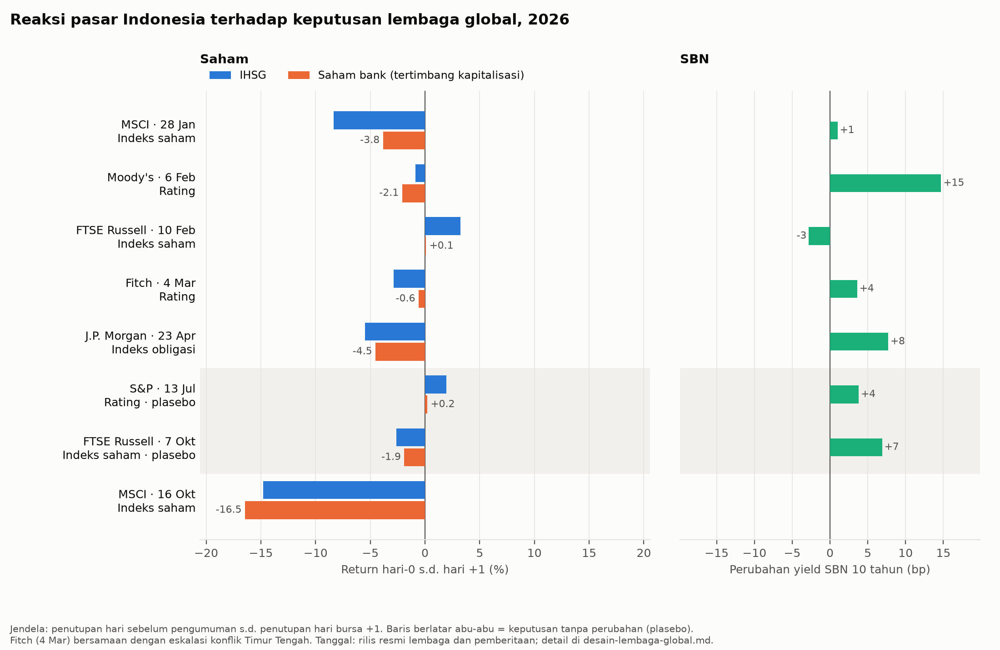
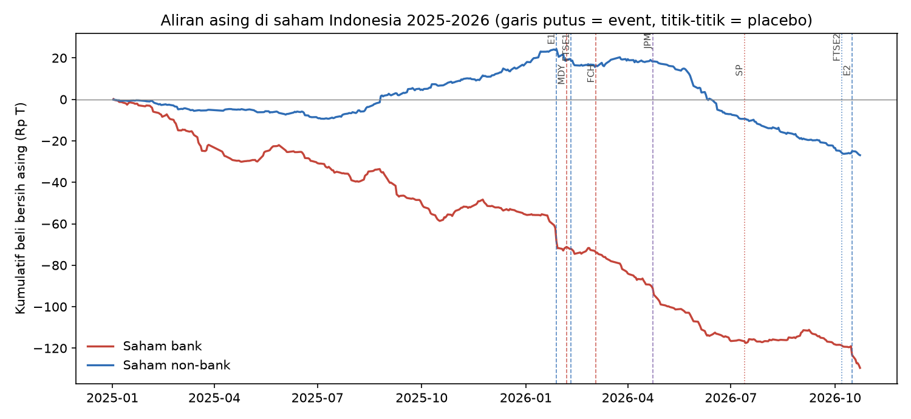

# Dihakimi dari Luar: siapa yang membayar ketika lembaga global menilai Indonesia?

Riset empiris tentang delapan keputusan enam lembaga global terhadap Indonesia sepanjang 2026: MSCI (dua kali), FTSE Russell (dua kali), J.P. Morgan GBI-EM, Moody's, Fitch, dan S&P. Pertanyaannya: seberapa besar dampaknya, saham siapa yang menanggung kerugian, dan lewat jalur apa. Ada juga "Gorengan Radar", model deep learning yang mengukur pola perdagangan bertata kelola lemah.

*English summary.* An event-study and machine-learning analysis of how eight 2026 decisions by global index providers and rating agencies hit Indonesian equities. Index decisions (MSCI) moved stocks 2–6× more than rating actions, which moved government bond yields instead. Who paid depended on the content of the decision: MSCI's free-float judgment hit weakly governed stocks, and the reclassification threat hit banks through concentrated foreign selling. A Transformer trained on Indonesia Stock Exchange surveillance labels predicts the January losses beyond the labels themselves, while an unsupervised autoencoder does not.

Status: hasil sementara (Oktober 2026). Working paper direncanakan Desember 2026.

## Temuan utama

| | Temuan | Bukti | Seberapa kuat |
|---|---|---|---|
| 1 | Penyedia indeks menggerakkan saham, lembaga rating menggerakkan obligasi | Synthetic control vs 13 negara EM: IHSG −7,9% (MSCI Jan) dan −12,1% (MSCI Okt), paling ekstrem dari semua negara pembanding; Moody's/Fitch: yield SBN +9 s.d. +12 bp | Kuat untuk saham; yield searah tetapi tidak ekstrem dibanding pembanding |
| 2 | Keputusan MSCI soal free float (E1) menghukum saham bertata kelola lemah | Saham yang pernah di-cooling down BEI tertinggal 8,0 pp dalam 6 hari; lebih ekstrem dari 60 hari crash biasa di 36 variasi definisi/spesifikasi | Sangat kuat |
| 3 | Ancaman reklasifikasi (E2) menghukum bank | Dummy bank −1,2 pp hari-0, DML −3,1 pp; 4 bank anggota MSCI: 17% kapitalisasi, 22% kerugian | Sedang |
| 4 | Kanalnya aliran asing yang terkonsentrasi di bank | Jual bersih asing Rp11,2 T (E1) dan Rp5,6 T (E2) dalam dua hari, hampir semua di bank; IV: jual 1% saham beredar → harga −10% (E2) | Kuat |
| 5 | Deep learning menangkap kelemahan yang dihukum MSCI, di luar label resmi | Skor Transformer pra-E1: −3,1 s.d. −3,8 pp per SD (8 varian), bertahan setelah label BEI dan run-up dikendalikan; gradient boosting dan autoencoder tidak | Kuat untuk E1 |

Status anggota MSCI sendiri tidak menjelaskan siapa yang jatuh setelah ukuran dikendalikan. Rincian dan batasan: [`hasil/laporan-hasil.md`](hasil/laporan-hasil.md).




## Metode

- **Event study lintas ±800 saham**, kontrol ukuran, beta, likuiditas, free float, momentum, dan PPK. Placebo dibuat dari 60–150 hari crash biasa, ditambah uji permutasi.
- **Synthetic control** antarnegara (13 donor EM) dengan placebo dalam ruang.
- **Double machine learning** (gradient boosting, cross-fitting), **causal forest** (econml), **variabel instrumental** untuk aliran asing (instrumen: bobot dan status MSCI), **local projections**, **connectedness** Diebold–Yilmaz.
- **Fingerprint bank**: 46 bank × 6 event, karakteristik neraca dari XBRL BEI, uji Wald antarjenis keputusan.
- **Gorengan Radar** (PyTorch, CPU):
  - Model: Transformer encoder pada jendela 30 hari, dilatih dengan loss BCE dan nnPU (positive-unlabeled, versi data tidak seimbang). Pembandingnya regresi logistik, gradient boosting, dan autoencoder MLP/GRU tanpa label.
  - Evaluasi out-of-time: latih ≤ Jun 2025, validasi Jul–Des 2025, uji 2026.
  - Uji ketahanan: 3 seed, 3 prior, atribusi permutasi, dan uji run-up reversal.

## Struktur

```
analisis/            pipeline bernomor (jalankan berurutan lewat jalankan.py)
  konfigurasi.py     path dan daftar 8 event
  00_*               mengurai dump data BEI
  01*_               membaca dan menyiapkan data (Refinitiv, BEI, XBRL, notasi, label)
  02-09              analisis ekonometrika
  10-15              Gorengan Radar (deep learning)
  tarik_bei/         skrip konsol browser untuk API publik idx.co.id
data/README.md       daftar data mentah dan cara mendapatkannya (data tidak disertakan)
docs/                desain penelitian, kajian literatur, catatan awal
hasil/               ringkasan, tabel, dan grafik (agregat)
refinitiv/           template Excel Refinitiv + panduan tarik data
```

## Menjalankan ulang

```bash
python -m venv .venv
.venv\Scripts\activate            # Windows; macOS/Linux: source .venv/bin/activate
pip install -r requirements.txt   # torch CPU: lihat komentar di requirements.txt
python analisis/jalankan.py --cek # data mentah apa yang masih kurang
python analisis/jalankan.py       # 01-09, sekitar 40 menit di laptop
python analisis/jalankan.py --radar --dari 10   # Gorengan Radar, beberapa jam di CPU
```

Hasil tertulis ke `hasil/` dan `hasil/lanjutan/`; log tiap tahap di `hasil/log_jalankan.txt`.

## Data dan etika

- Data Refinitiv tidak disertakan karena berlisensi. Data BEI bersifat publik dan bisa ditarik ulang dengan skrip di `analisis/tarik_bei/`. Lihat [`data/README.md`](data/README.md).
- Label pengawasan BEI dan skor Gorengan Radar per saham hanya dipakai secara agregat. Repo ini tidak memuat daftar saham "gorengan", dan hasilnya bukan rekomendasi jual atau beli.
- Konstituen MSCI masih berupa proksi (kepemilikan ETF EIDO dan kapitalisasi free float), karena kode konstituen dari Refinitiv kembali kosong.

## Penulis

Daffa, Ekonomi Pembangunan, Universitas Negeri Semarang.
