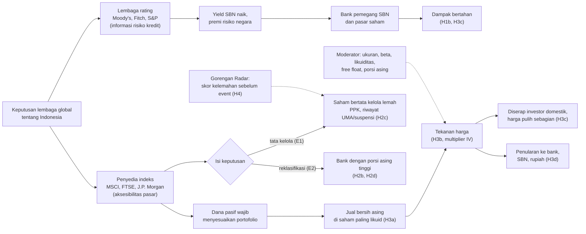

# Dihakimi dari Luar: lembaga global menilai Indonesia

Sepanjang 2026, enam lembaga global mengeluarkan delapan keputusan tentang Indonesia. Dua di antaranya dari MSCI, dan keduanya menjatuhkan IHSG lebih dari 7% dalam sehari. Riset ini mengukur seberapa besar dampak tiap keputusan, saham siapa yang menanggung kerugiannya, dan lewat jalur apa kerugian itu terjadi. Datanya mencakup ±790 saham BEI, 46 bank, yield SBN, rupiah, dan 13 pasar berkembang pembanding.

Status: hasil sementara, data sampai 23 Oktober 2026. Policy brief direncanakan terbit 10 November 2026 dan working paper pada Desember 2026. Angka di bawah masih bisa berubah setelah daftar konstituen MSCI resmi ditarik dari Refinitiv.

Dokumen ini ditulis supaya pembaca bisa memahami riset tanpa menjalankan kodenya. Urutannya: latar belakang, pertanyaan riset, posisi terhadap literatur, data, metode, hasil, batasan, lalu cara menjalankan ulang.

## Daftar isi

1. [Latar belakang](#1-latar-belakang)
2. [Pertanyaan riset dan hipotesis](#2-pertanyaan-riset-dan-hipotesis)
3. [Posisi terhadap literatur](#3-posisi-terhadap-literatur)
4. [Event yang diteliti](#4-event-yang-diteliti)
5. [Data](#5-data)
6. [Metode](#6-metode)
7. [Hasil](#7-hasil)
8. [Batasan](#8-batasan)
9. [Etika dan penggunaan data](#9-etika-dan-penggunaan-data)
10. [Struktur repo dan cara menjalankan ulang](#10-struktur-repo-dan-cara-menjalankan-ulang)
11. [Rencana lanjutan](#11-rencana-lanjutan)
12. [Rujukan](#12-rujukan)

## 1. Latar belakang

Ada dua jenis lembaga global yang keputusannya menggerakkan pasar Indonesia.

- **Lembaga rating** (Moody's, Fitch, S&P) menilai risiko kredit negara. Keputusan mereka membawa informasi tentang fundamental: kemampuan pemerintah membayar utang.
- **Penyedia indeks** (MSCI, FTSE Russell, J.P. Morgan) menilai apakah pasar mudah diakses investor asing. Keputusan mereka mengubah komposisi indeks, dan dana pasif yang mengikuti indeks wajib membeli atau menjual sesuai komposisi itu. Jual-beli ini terjadi karena aturan dana, walaupun kondisi perusahaannya tidak berubah.

Pada 27 Januari 2026 malam, MSCI membekukan rebalancing Indonesia karena meragukan kualitas free float dan keterbukaan kepemilikan. Esoknya IHSG turun 7,35% dan perdagangan sempat dihentikan. Pada 15 Oktober 2026, MSCI membuka konsultasi untuk menurunkan Indonesia dari Emerging Market ke Standalone. Esoknya IHSG turun 11,6%, penurunan harian terdalam sejak 1998. Keputusan final MSCI paling lambat Juni 2027.

Di antara dua pengumuman itu, Moody's dan Fitch menurunkan outlook Indonesia menjadi negatif, J.P. Morgan menurunkan batas bobot Indonesia di indeks obligasi GBI-EM, dan FTSE Russell dua kali mengumumkan keputusan yang tidak mengubah status Indonesia. Rangkaian ini memungkinkan perbandingan reaksi pasar yang sama terhadap dua jenis lembaga dalam satu tahun.

## 2. Pertanyaan riset dan hipotesis

Pertanyaan umum: **ketika lembaga global menilai Indonesia, siapa yang menanggung kerugiannya, dan lewat jalur apa?** Pertanyaan ini dipecah menjadi empat pertanyaan riset (RQ) dan dua pertanyaan pendukung.

### RQ1. Seberapa besar dampaknya, dan apakah berbeda menurut jenis lembaga?

Apakah keputusan penyedia indeks, yang tidak membawa informasi fundamental, menggerakkan pasar saham lebih kuat daripada keputusan lembaga rating? Apakah lembaga rating justru lebih terasa di pasar obligasi?

- H1a: keputusan penyedia indeks menurunkan IHSG dan saham bank lebih dalam daripada keputusan rating, setelah dibandingkan dengan pasar berkembang lain pada hari yang sama.
- H1b: keputusan rating menaikkan yield SBN, sedangkan keputusan penyedia indeks saham tidak.
- H1c: event placebo (afirmasi S&P dan keputusan FTSE yang tidak mengubah status) tidak menunjukkan dampak.

### RQ2. Saham siapa yang menanggung kerugian?

Di dalam satu hari event, saham dengan karakteristik apa yang jatuh lebih dalam, setelah ukuran, beta, likuiditas, free float, dan momentum dikendalikan?

- H2a: saham anggota indeks MSCI jatuh lebih dalam daripada saham non-anggota dengan ukuran serupa.
- H2b: bank jatuh lebih dalam, karena bank adalah saham yang paling banyak dipegang asing.
- H2c: saham bertata kelola lemah (Papan Pemantauan Khusus, riwayat UMA atau suspensi) jatuh lebih dalam pada keputusan yang isinya menyangkut tata kelola (E1).
- H2d: sidik jari neraca bank yang terpukul berbeda antara keputusan indeks dan keputusan rating.

### RQ3. Lewat jalur apa kerugian itu terjadi?

- H3a: keputusan indeks memicu jual bersih asing yang tidak biasa, terutama di saham bank. Keputusan rating tidak.
- H3b: jual asing yang dipaksa oleh mekanika indeks menurunkan harga (efek kausal, bukan sekadar korelasi).
- H3c: setelah keputusan indeks, harga pulih sebagian karena guncangannya berasal dari aliran dana. Setelah keputusan rating, harga tidak pulih karena guncangannya membawa informasi.
- H3d: setelah keputusan indeks, keterkaitan antara saham, bank, SBN, dan rupiah meningkat.
- Pertanyaan tambahan: kalau asing menjual, siapa yang membeli?

### RQ4. Bisakah kelemahan yang dihukum pasar diukur sebelum event?

Kalau E1 menghukum saham bertata kelola lemah, bisakah pola perdagangan harian mengidentifikasi saham seperti itu sebelum pengumuman, termasuk saham yang belum pernah ditandai BEI?

- H4: skor model deep learning yang dilatih dari label pengawasan BEI, dihitung 20 hari sebelum E1, memprediksi siapa yang jatuh lebih dalam saat E1. Prediksi ini bertahan setelah riwayat pengawasan BEI dan kenaikan harga sebelum event dikendalikan.

### Pertanyaan pendukung

- **Seberapa langka?** Bagaimana kejatuhan E1 dan E2 dibanding semua kejatuhan harian ≥5% di 14 pasar berkembang sejak 2010?
- **Apa yang bisa terjadi berikutnya?** Apa pelajaran dari negara yang benar-benar diturunkan MSCI (Argentina 2021), dan berapa besar jual paksa kalau MSCI mengeluarkan Indonesia?

### Kerangka konseptual



Cara membaca diagram:

- **Dua jalur.** Lembaga rating membawa informasi tentang kemampuan negara membayar utang. Dampaknya diharapkan muncul di yield SBN dan bertahan, karena pasar menilai ulang risiko. Penyedia indeks tidak membawa informasi baru tentang perusahaan. Dampaknya datang dari kewajiban dana pasif mengikuti indeks, sehingga harga diharapkan pulih setelah penjualan selesai dan ada pembeli lain.
- **Jalur indeks bercabang menurut isi keputusan.** Keputusan soal tata kelola dan free float (E1) diharapkan menghukum saham yang tata kelolanya lemah. Ancaman reklasifikasi (E2) diharapkan menghukum saham yang paling banyak dipegang asing, yaitu bank besar.
- **Moderator** menentukan seberapa besar satu saham terpukul pada event yang sama, dan karena itu dikendalikan di semua regresi.
- **Gorengan Radar** adalah ukuran kelemahan tata kelola yang dihitung sebelum event. Radar menguji apakah cabang E1 bisa diprediksi lebih awal.
- Label H1a sampai H4 di diagram merujuk ke hipotesis di atas. Hasil tiap hipotesis ada di bagian 7.

## 3. Posisi terhadap literatur

Riset ini bukan studi pertama tentang reaksi pasar Indonesia terhadap MSCI 2026. Bedanya ada di pertanyaan yang diajukan.

| Studi | Yang dilakukan | Yang ditambahkan riset ini |
|---|---|---|
| Al-Kharaj (2026) | Event study 39 saham LQ45 untuk E1. Abnormal return tidak signifikan | Seluruh ±790 saham, membandingkan siapa jatuh lebih dalam. Rata-rata yang tidak signifikan bisa menutupi kelompok yang jatuh sangat dalam dan kelompok yang terlindung |
| JAP Unram (Mei 2026) | 17 konstituen MSCI untuk E1 | Membandingkan anggota dan non-anggota MSCI, dengan placebo dari hari crash biasa |
| Burnham, Gakidis & Wurgler (2018) | 17 reklasifikasi MSCI 2000–2015. Harga turun dari pengumuman sampai tanggal efektif, lalu berbalik dalam setahun | Dipakai sebagai landasan untuk H3c, lalu diperluas ke dalam satu negara: saham mana yang kena dan peran bank |
| Literatur pengumuman rating negara | Reaksi saham, obligasi, dan CDS terhadap perubahan rating | Membandingkan langsung lembaga rating dan penyedia indeks untuk negara dan tahun yang sama |
| Literatur deteksi manipulasi saham | Sebagian besar memakai data order book dan label sintetis atau sangat sedikit | Data harian BEI, label dari pengumuman pengawasan BEI, dan positive-unlabeled learning karena saham tanpa label belum tentu bersih |

Kontribusi yang diajukan, dengan catatan bahwa pencarian literatur sistematis di Scopus (query Q8–Q11 di [`docs/kajian-literatur-model.md`](docs/kajian-literatur-model.md)) belum selesai:

1. Mengukur siapa yang menanggung kerugian di dalam satu negara, dengan placebo dari hari crash biasa.
2. Membandingkan penyedia indeks dan lembaga rating untuk negara yang sama.
3. Menunjukkan bahwa isi keputusan menentukan siapa yang membayar: keputusan tata kelola dan ancaman reklasifikasi menghukum kelompok saham yang berbeda.
4. Membangun ukuran kelemahan tata kelola berbasis deep learning untuk BEI, lalu mengujinya terhadap kerugian akibat keputusan MSCI.

## 4. Event yang diteliti

Hari-0 adalah hari bursa BEI pertama yang bisa bereaksi terhadap pengumuman. Pengumuman yang keluar setelah BEI tutup mendapat hari-0 keesokan harinya.

| Kode | Hari-0 | Lembaga | Keputusan | Peran |
|---|---|---|---|---|
| E1 | 28 Jan 2026 | MSCI | Pembekuan rebalancing karena isu free float dan kepemilikan | Event indeks |
| MDY | 6 Feb 2026 | Moody's | Outlook Baa2 dari stabil menjadi negatif | Event rating |
| FTSE1 | 10 Feb 2026 | FTSE Russell | Penundaan review Maret | Event indeks |
| FCH | 4 Mar 2026 | Fitch | Outlook BBB dari stabil menjadi negatif | Event rating, tercampur eskalasi konflik Timur Tengah |
| JPM | 23 Apr 2026 | J.P. Morgan | Batas bobot GBI-EM turun dari 10% ke 9% | Event indeks obligasi |
| SP | 13 Jul 2026 | S&P | Afirmasi BBB stabil | Placebo |
| FTSE2 | 7 Okt 2026 | FTSE Russell | Status Secondary Emerging dipertahankan | Placebo |
| E2 | 16 Okt 2026 | MSCI | Konsultasi penurunan ke Standalone | Event indeks |

Alasan pemilihan lembaga dan event yang sengaja tidak dimasukkan ada di [`docs/desain-lembaga-global.md`](docs/desain-lembaga-global.md).

## 5. Data

Data tidak disertakan di repo. Data Refinitiv berlisensi, dan data publik BEI berukuran ratusan MB. Daftar lengkap berkas dan cara mendapatkannya ada di [`data/README.md`](data/README.md).

| Sumber | Isi | Periode |
|---|---|---|
| Refinitiv (langganan kampus) | Total return 890 saham BEI; 69 seri pasar: indeks saham, kurs, dan yield 10 tahun 13 negara berkembang | Saham 2025–16 Okt 2026; pasar sejak 2010 |
| BEI, Ringkasan Saham (API publik) | Harga, volume, nilai, jual-beli asing, saham tercatat, free float, papan pencatatan, sektor, notasi khusus | 2020–23 Okt 2026 |
| BEI, pengumuman UMA dan suspensi | 1.191 UMA dan 1.926 pengumuman suspensi | Okt 2023–Okt 2026 |
| BEI, laporan keuangan XBRL | Neraca 49 bank | Des 2025 dan Jun 2026 |
| KSEI, dirilis BEI | Kepemilikan saham per tipe investor, lokal dan asing; pemegang di atas 5% | Nov 2025–Sep 2026; 15 dan 22 Okt 2026 |
| iShares EIDO | Kepemilikan ETF sebagai proksi konstituen MSCI Indonesia | 21 Okt 2026 |
| Bank Indonesia, PHEI | Kurs JISDOR; kurva yield SBN | 12–23 Okt 2026 |
| Yahoo Finance | ARGT, EEM, Merval, kurs peso | 2020–2022 |

### Jumlah observasi dan periode

Datanya terdiri dari tiga lapis. Lapis pertama adalah data mentah. Lapis kedua adalah sampel estimasi event study, yaitu ±790 saham per event. Lapis ketiga adalah dataset Gorengan Radar.

| Data | Periode | Unit | Hari bursa | Total observasi |
|---|---|---|---|---|
| Panel harga saham utama (BEI dan Refinitiv) | 2 Jan 2020 – 23 Okt 2026 | 987 saham | 1.640 | 1.322.888 saham-hari |
| BEI Ringkasan Saham 2020–2024 | 2 Jan 2020 – 30 Des 2024 | 956 saham | 1.211 | 977.749 saham-hari |
| BEI Ringkasan Saham 2025–2026 | 2 Jan 2025 – 23 Okt 2026 | 980 saham | 429 | 411.232 saham-hari |
| BEI Ringkasan Saham lengkap (untuk radar) | 2 Okt 2023 – 30 Des 2024 | 948 saham | 300 | 277.799 saham-hari |
| Seri pasar antarnegara | 30 Des 2009 – 23 Okt 2026 | 69 seri | 4.084 | ±280 ribu titik |
| Perbandingan antarnegara | 2010 – Okt 2026 | 14 negara | – | 55.031 negara-hari, 178 episode turun ≥5% |
| Laporan keuangan bank (XBRL) | Des 2025, Jun 2026 | 49 bank | – | 96 laporan |
| Kepemilikan KSEI | Nov 2025 – Sep 2026 | 49 saham bank per bulan | – | 11 bulan; pemegang >5%: 78 posisi di 38 bank |
| Label pengawasan BEI | Okt 2023 – Okt 2026 | pengumuman | – | 1.191 UMA, 1.926 suspensi |

Sampel estimasi per analisis:

| Analisis | Unit | Jumlah |
|---|---|---|
| Event study, DML, variabel instrumental | saham per event | 792 (E1), 785 (E2), ±780–800 di event lain; 8 event |
| Placebo hari crash biasa | hari × saham | 38–150 hari, masing-masing ±790 saham |
| Causal forest | saham-hari | 1.577 saham-hari di 2 hari MSCI, dibanding 40 hari crash biasa |
| Synthetic control | negara | Indonesia dan 12–13 negara donor, per event dan per seri |
| Sidik jari bank | bank × event | 46 bank × 6 event = 276 |
| Aliran asing | saham-hari | seluruh hari bursa 2 Jan 2025 – 23 Okt 2026 (429 hari) |

Dataset Gorengan Radar, dengan satu observasi berupa jendela 30 hari bursa untuk satu saham:

| Bagian | Periode | Jendela | Positif (UMA/suspensi dalam 5 hari) |
|---|---|---|---|
| Latih | Okt 2023 – Jun 2025 | 352.621 | – |
| Validasi | Jul – Des 2025 | 120.338 | 2.719 (2,3%) |
| Uji | Jan – 16 Okt 2026 | 179.558 | 2.296 (1,3%) |
| Total | | 652.517 jendela dari 976 saham | |

Jumlah jendela latih dihitung dari total dikurangi validasi dan uji. Panel harga 2020–2024 berisi return harga tanpa dividen.

### Pembersihan data

Pembersihan data yang memengaruhi hasil:

- Status Papan Pemantauan Khusus (PPK) diambil per tanggal event dari kolom Remarks BEI. Saat E1 ada 181 saham PPK, sedangkan pada Oktober tinggal 69 karena BEI merevisi kriterianya pada 28 September 2026.
- Saham yang tidak bertransaksi di hari-0 dikeluarkan dari regresi hari-0. Pada E2, 79% saham PPK tidak bertransaksi, sehingga tanpa langkah ini muncul efek palsu.
- Yield 10 tahun yang persis sama dengan hari sebelumnya dianggap kuotasi basi dan dikosongkan (4.260 titik).
- Return BEI 2020–2024 adalah return harga tanpa dividen. Sambungan ke total return Refinitiv dibuat agar return 2 Januari 2025 sama dengan return BEI hari itu.

## 6. Metode

Event utamanya hanya delapan, dan event MSCI hanya dua. Karena itu analisis bertumpu pada variasi ±790 saham di dalam tiap event, dengan pembanding yang dipilih untuk setiap pertanyaan.

### 6.1 Event study lintas saham (RQ2)

Untuk setiap event, return kumulatif (CAR) setiap saham diregresikan terhadap karakteristiknya: anggota MSCI, bank, PPK, atau riwayat pengawasan. Variabel kontrolnya ukuran, beta terhadap IHSG dan MSCI EM, likuiditas, free float, dan momentum. Beta diestimasi pada hari [−250, −30], dengan hari di sekitar event lain dikeluarkan supaya crash E1 tidak menggelembungkan beta.

Jendela yang dipakai: hari-0, [0,+1], dan [0,+5]. Galat baku memakai HC3. Sebagai uji ketahanan, kontrol ukuran diganti dengan fixed effect desil ukuran, sehingga anggota MSCI hanya dibandingkan dengan non-anggota yang ukurannya serupa.

### 6.2 Placebo dan uji permutasi (semua RQ)

Pada hari pasar jatuh, saham kecil atau bank mungkin selalu jatuh lebih dalam. Jadi koefisien di hari event dibandingkan dengan koefisien yang sama di hari-hari crash biasa, yaitu 38 sampai 150 hari terburuk yang bukan hari event, tergantung ujinya. p placebo adalah porsi hari crash biasa yang koefisiennya seekstrem atau lebih ekstrem dari hari event. Dengan 60 hari placebo, nilai terkecil yang mungkin adalah 1/61 ≈ 0,016.

Uji permutasi mengacak label (misalnya status anggota MSCI) ribuan kali untuk melihat seberapa sering hasil acak menyamai hasil asli.

### 6.3 Synthetic control antarnegara (RQ1)

Indonesia dibandingkan dengan "Indonesia sintetis": kombinasi berbobot dari 13 pasar berkembang yang meniru pergerakan Indonesia sebelum event (Abadie dkk., 2010). Selisih keduanya di hari event adalah dampak event. Seri yang diuji adalah IHSG, indeks bank, dan yield SBN 10 tahun. Signifikansi diuji dengan placebo dalam ruang: setiap negara donor diperlakukan seolah terkena event, lalu dilihat apakah gap Indonesia paling ekstrem. Dengan 12–13 donor, p terkecil yang mungkin adalah 0,071–0,077.

### 6.4 Double machine learning (RQ2)

Hubungan antara kontrol dan return belum tentu linear. Double machine learning (Chernozhukov dkk., 2018) memakai gradient boosting untuk memprediksi return dan status perlakuan (misalnya "bank") dari semua kontrol, lalu meregresikan sisa prediksi yang satu terhadap sisa prediksi yang lain. Cross-fitting 5 lipatan dengan 5 ulangan mencegah model memakai data yang sama untuk belajar dan mengukur.

### 6.5 Causal forest (RQ2)

Causal forest (Wager & Athey, 2018; paket econml) mencari karakteristik yang membuat efek event lebih besar atau lebih kecil. Outcome-nya adalah peringkat persentil return saham, dibandingkan antara 2 hari MSCI dan 40 hari crash biasa.

### 6.6 Sidik jari bank (RQ2)

Reaksi 46 bank di 6 event diregresikan terhadap karakteristik neraca dari XBRL BEI: rasio modal, LDR, porsi surat berharga sebagai proksi SBN, pendanaan wholesale, utang repo, CASA, dan porsi transaksi asing dalam 60 hari sebelum E1. Uji Wald menguji apakah sekumpulan koefisien di event indeks sama dengan di event rating.

### 6.7 Aliran asing dan kepemilikan (RQ3)

Jual bersih asing [0,+1] per event dibandingkan dengan semua jendela dua hari lain sepanjang 2025–2026. Untuk menjawab siapa pembelinya, perubahan kepemilikan KSEI per tipe investor (individu, reksa dana, dana pensiun, asuransi, korporasi, dan lain-lain) dihitung antara akhir bulan sebelum dan sesudah event. Hasilnya dicek silang dengan aliran asing harian BEI.

### 6.8 Variabel instrumental untuk aliran asing (RQ3)

Regresi biasa antara jual asing dan return bias, karena asing cenderung menjual saham yang memang akan jatuh. Jual bersih asing (persen saham beredar) diinstrumenkan dengan bobot dan status MSCI, yang menentukan berapa banyak dana pasif harus menjual. Estimasi memakai 2SLS (paket linearmodels). Asumsinya, bobot MSCI memengaruhi return hanya lewat penjualan itu. Asumsi ini tidak bisa diuji langsung dan dibahas di bagian batasan.

### 6.9 Local projections (RQ3)

Untuk setiap horizon h = 0 sampai 20 hari, perubahan harga dari hari sebelum event ke hari h diregresikan pada dummy jenis event (Jordà, 2005). Hasilnya menunjukkan apakah dampak pulih atau terus berlanjut.

### 6.10 Connectedness (RQ3)

Model VAR bergulir 200 hari atas IHSG, indeks bank, yield SBN, dan rupiah, lalu dekomposisi varians galat ramalan 10 hari (Diebold & Yilmaz, 2012). Indeks total mengukur seberapa besar guncangan satu pasar menular ke pasar lain. Net transmitter adalah pasar yang lebih banyak menularkan daripada menerima.

### 6.11 Gorengan Radar (RQ4)

**Tugas model.** Memprediksi apakah sebuah saham akan terkena UMA atau suspensi pengawasan BEI dalam 5 hari bursa ke depan. Inputnya pola 30 hari terakhir: return, rentang harga harian, lonjakan nilai dan frekuensi transaksi, turnover, transaksi asing, pasar negosiasi, papan, dan notasi khusus.

**Model utama.** Transformer encoder (Vaswani dkk., 2017) yang membaca 30 hari sebagai satu urutan, dilatih dengan PyTorch di CPU. Ada dua cara melatihnya:

- Loss BCE biasa, yang menganggap saham tanpa label sebagai saham bersih.
- Loss nnPU (Kiryo dkk., 2017) dalam versi untuk data tidak seimbang (Su dkk., 2021). Saham tanpa label diperlakukan sebagai "belum diketahui", karena bisa saja belum tertangkap BEI. Prior π adalah tebakan porsi saham bermasalah di antara saham tanpa label.

**Pembanding.** Regresi logistik, gradient boosting, dan autoencoder MLP serta GRU yang dilatih tanpa label. Autoencoder menguji apakah yang dihukum pasar sekadar "pola perdagangan aneh" secara umum.

**Evaluasi.** Pembagian berdasarkan waktu: latih Oktober 2023 sampai Juni 2025, pilih model di Juli–Desember 2025, uji di 2026. Semua event berada di periode uji, jadi model tidak pernah melihat data event. Akurasi dilaporkan juga di dalam kelompok ukuran yang sama, supaya model tidak sekadar belajar "saham kecil berisiko".

**Uji terhadap event.** Skor rata-rata 20 hari sebelum event dimasukkan ke regresi event study 6.1, lalu dibandingkan dengan 38 hari crash biasa.

**Uji ketahanan.** Tiga seed, tiga nilai prior π (0,005; 0,01; 0,03), atribusi fitur dengan permutasi, dan uji run-up reversal. Uji terakhir memeriksa apakah skor tinggi hanya menandai saham yang naik tajam sebelum event lalu berbalik.

### 6.12 Analisis pendukung

- **Perbandingan antarnegara.** Semua hari ketika indeks saham salah satu dari 14 pasar berkembang turun ≥5% sejak 2010. Untuk setiap episode dihitung return di atas MSCI EM, perubahan kurs, dan porsi kejatuhan yang pulih dalam 5 hari.
- **Argentina 2021.** Event study harian ARGT dikurangi EEM di sekitar peringatan MSCI (Juni 2020), keputusan turun ke Standalone (Juni 2021), dan tanggal efektif (November 2021).
- **Skenario jual paksa.** Estimasi arus keluar dana pasif US$5,6 miliar (dengan variasi US$3,25 sampai lebih dari US$8 miliar) dibagi ke saham menurut bobot EIDO, dengan kurs JISDOR Rp18.069.

## 7. Hasil

Ringkasan per hipotesis. "Kuat" berarti lolos uji utama, placebo, dan minimal satu uji ketahanan. Rincian semua angka ada di [`hasil/laporan-hasil.md`](hasil/laporan-hasil.md).

| Hipotesis | Hasil | Status |
|---|---|---|
| H1a indeks > rating di saham | Synthetic control hari-0: IHSG −7,9% (E1) dan −12,1% (E2), paling ekstrem dari semua donor. Rating: −2,0% (Moody's) dan −4,5% (Fitch, p 0,50) | Didukung |
| H1b rating menggerakkan SBN | Yield +12 bp (Moody's) dan +9 bp (Fitch). Arahnya sesuai, tetapi tidak paling ekstrem dibanding donor (p 0,15–0,23) | Searah, belum kuat |
| H1c placebo nol | S&P dan FTSE Oktober tidak menunjukkan dampak pada saham maupun aliran asing | Didukung |
| H2a anggota MSCI lebih dalam | Hanya muncul dengan kontrol ukuran linear. Hilang dengan fixed effect desil ukuran dan dengan DML | Tidak didukung |
| H2b bank lebih dalam | E2: −1,2 pp di hari-0 (p 0,039), DML −3,0 pp (p 0,036). E1 sebaliknya: bank terlindung, +5,9 pp di [0,+5] | Didukung di E2 saja |
| H2c tata kelola lemah di E1 | Saham dengan riwayat UMA atau suspensi tertinggal 8,0 pp di [0,+5], lebih ekstrem dari semua 60 hari crash biasa | Kuat |
| H2d sidik jari berbeda | Bank dengan porsi transaksi asing tinggi jatuh lebih dalam di event indeks (Wald p 0,027), tetapi hasil ini hilang kalau E2 dibuang | Hanya E2 dan J.P. Morgan |
| H3a jual asing di event indeks | E1 −Rp11,2 T, E2 −Rp5,6 T, J.P. Morgan −Rp4,3 T dalam dua hari, sebagian besar di bank. Event rating tidak berbeda dari hari biasa | Kuat |
| H3b efek kausal jual asing | IV E2: jual bersih 1% saham beredar menurunkan harga 10% (F tahap pertama 170) | Kuat untuk E2 |
| H3c indeks pulih, rating tidak | E2 pulih 51% dalam lima hari. Setelah keputusan rating, bank terus turun sampai sekitar −7% di hari ke-20 | Searah, event rating sedikit |
| H3d keterkaitan naik | Indeks connectedness naik dari ±13 ke ±33; bank menjadi penular terbesar setelah E2 | Didukung, deskriptif |
| H4 radar memprediksi E1 | −3,1 sampai −3,8 pp per simpangan baku skor, di 8 varian Transformer | Kuat untuk E1 |

### 7.1 RQ1: seberapa besar

| Event | IHSG | Indeks bank | Yield SBN 10 th |
|---|---|---|---|
| E1 MSCI | −7,9% | −6,6% | +2,8 bp |
| Moody's | −2,0% | −1,5% | +12,3 bp |
| FTSE Feb | +1,7% | −1,0% | −2,5 bp |
| Fitch | −4,5% | −1,3% | +9,2 bp |
| J.P. Morgan | −1,7% (−6,5% di hari +5) | −0,2% (−5,9% di hari +5) | +2,0 bp |
| S&P (placebo) | tidak dihitung | tidak dihitung | −7,5 bp |
| FTSE Okt (placebo) | 0,0% | +1,7% | −1,8 bp |
| E2 MSCI | −12,1% | −13,9% | tidak valid (data basi sejak 13 Okt) |

Angka di atas adalah selisih Indonesia dengan Indonesia sintetis di hari-0. Kerugian kapitalisasi pasar di hari-0 sekitar Rp1.226 triliun pada E1 dan Rp1.097 triliun pada E2.

Dibanding pasar berkembang lain, E2 adalah kejatuhan idiosinkratik terbesar di 14 pasar sejak 2010: IHSG turun 12,4 poin persen lebih dalam dari MSCI EM. Dari sekitar 54 ribu hari-negara, hanya 11 yang lebih buruk, dan semuanya hari krisis global kecuali satu. Rupiah hanya melemah 0,45% saat E2 dan justru menguat 0,36% saat E1. Pola ini berbeda dari krisis kepercayaan seperti di Turki pada Maret 2021, ketika saham turun 9,8% dan lira melemah 8,1% pada hari yang sama.

### 7.2 RQ2: siapa yang membayar

Isi keputusan menentukan siapa yang membayar.

- **E1, keputusan soal tata kelola.** Saham PPK tertinggal 4,7 pp di [0,+1] (p < 0,001; placebo p 0,033). Saham yang pernah terkena UMA atau suspensi dalam setahun terakhir tertinggal 8,0 pp di [0,+5]. Di 36 kombinasi definisi dan spesifikasi, efeknya berkisar −6,2 sampai −12,2 pp dan selalu lebih ekstrem dari semua 60 hari crash biasa. Kelompok ini hanya 19,7% kapitalisasi pasar, tetapi menanggung 30,6% kerugian [0,+1]. Bank justru terlindung.
- **E2, ancaman reklasifikasi.** Beban pindah ke bank. Empat bank anggota MSCI mewakili 17% kapitalisasi, tetapi menanggung 22–23% kerugian. Bank yang paling banyak diperdagangkan asing jatuh paling dalam.
- **Status anggota MSCI sendiri tidak menjelaskan siapa yang jatuh** setelah ukuran dikendalikan dengan benar.
- **Causal forest** tidak menemukan karakteristik yang jelas membedakan besar efek. Semua interval melewati nol, karena hanya ada dua hari perlakuan.

### 7.3 RQ3: lewat jalur apa

| Event | Jual bersih asing [0,+1], pasar | Bank | p (bank, dibanding hari biasa) |
|---|---|---|---|
| E1 MSCI | −Rp11,2 T | −Rp9,8 T | 0,003 |
| Moody's | +Rp0,2 T | −Rp0,7 T | 0,83 |
| FTSE Feb | −Rp1,2 T | −Rp0,5 T | 0,99 |
| Fitch | −Rp0,5 T | −Rp0,8 T | 0,70 |
| J.P. Morgan | −Rp4,3 T | −Rp4,1 T | 0,017 |
| S&P (placebo) | −Rp1,3 T | −Rp1,3 T | 0,40 |
| FTSE Okt (placebo) | −Rp1,7 T | −Rp0,7 T | 0,81 |
| E2 MSCI | −Rp5,6 T | −Rp6,4 T | 0,003 |

- **Konsentrasi di bank.** Sepanjang 2025 sampai Oktober 2026, asing menjual bersih sekitar Rp130 triliun saham bank, dibanding −Rp27 triliun di saham non-bank.
- **Efek kausal.** Dengan instrumen bobot MSCI, jual bersih 1% saham beredar di E2 menurunkan harga sekitar 10%. Regresi biasa justru tidak memberi tanda negatif, yang menunjukkan bias seleksinya besar.
- **Siapa pembelinya.** Pada Januari, pembeli bersih terbesar saham bank adalah investor individu (98% lokal) dengan +Rp8,7 T, hampir tiga kali bulan biasa. Asuransi dan korporasi tidak membeli lebih dari biasanya. Pada 16–23 Oktober, asing menjual bersih saham bank Rp10,5 T dan tetap menjual ketika harga pulih. Dari 78 posisi pemegang di atas 5% di 38 bank, hanya satu yang berubah. Jadi penyerapnya investor domestik dengan kepemilikan di bawah 5%. Rincian per tipe investor untuk Oktober menunggu data KSEI awal November.
- **Pulih atau tidak.** E2 pulih 51% dalam lima hari, lebih cepat dari median kejatuhan lokal di negara lain (32%). Setelah keputusan rating, saham bank terus turun sampai sekitar −7% di hari ke-20 dan yield SBN naik sekitar 16 bp.
- **Penularan.** Indeks connectedness naik dari ±13 pada Maret ke ±33 pada Oktober. Setelah E2, bank menjadi net transmitter terbesar (+4,8).

### 7.4 RQ4: Gorengan Radar

Akurasi menebak label BEI di periode uji 2026 (basis positif 1,3%):

| Model | AUC | Presisi pada 1% skor tertinggi |
|---|---|---|
| Gradient boosting | 0,87 | 25% |
| Transformer BCE | 0,83 | 16% |
| Regresi logistik | 0,81 | 17% |
| Transformer nnPU | 0,80 | 4% |
| Autoencoder (tanpa label) | 0,66–0,67 | tidak dihitung |

Presisi nnPU terhadap label memang rendah, karena model ini tidak menganggap saham tanpa label sebagai saham bersih.

Hasil yang lebih penting adalah uji terhadap E1:

- Skor Transformer 20 hari sebelum E1 memprediksi kerugian E1: −3,1 sampai −3,8 pp per simpangan baku skor di [0,+5], di 8 varian (3 seed BCE, 3 seed nnPU, 3 prior). p placebo 0,026–0,051.
- Setelah riwayat suspensi BEI dikendalikan, efeknya −1,8 sampai −2,7 pp. Artinya radar menangkap kelemahan di luar label resmi.
- Bukan run-up reversal: dengan kontrol run-up yang fleksibel efeknya −4,4 pp, dan di saham yang tidak naik tajam sebelum event −4,9 pp.
- Gradient boosting, model paling akurat, tidak lolos (p placebo 0,10–0,33). Autoencoder juga tidak (p 0,23–0,31). Artinya E1 menghukum saham yang polanya mirip dengan saham yang pernah ditandai BEI. Saham yang perdagangannya sekadar tidak biasa tidak ikut dihukum.
- Sinyal nnPU terutama berasal dari rentang harga harian.
- Di E2 dan event rating, skor radar tidak memprediksi kerugian. Di J.P. Morgan efeknya sebagian berasal dari run-up, jadi klaim yang aman hanya untuk E1.

### 7.5 Pendukung: Argentina dan skenario

- **Argentina.** Keputusan MSCI menurunkan Argentina ke Standalone (24 Juni 2021) hanya membuat ARGT tertinggal 2,9 pp dari EEM pada hari pertama, sekitar empat kali lebih kecil dari E2. Investor asing di Argentina sudah terkunci kontrol modal sejak 2019, jadi tidak ada arus keluar yang bisa terjadi serentak. Setahun setelah tanggal efektif, ARGT naik 33 pp di atas EEM. Pola turun lalu berbalik ini sama dengan temuan Burnham dkk. (2018) untuk sembilan pasar yang dipindah ke indeks yang lebih sedikit diikuti investor: rata-rata −12,5% dari pengumuman sampai tanggal efektif, lalu +23% setahun kemudian.
- **Skenario jual paksa.** Kalau MSCI mengeluarkan Indonesia, skenario tengah memberi jual paksa sekitar Rp101 triliun, separuhnya di saham bank (BBCA sekitar Rp21,5 triliun). Angka ini sekitar lima kali jual asing di bank selama enam hari setelah E2. Ekstrapolasi multiplier IV ke angka ini (sekitar −33% untuk bank) hanya batas atas kasar dan tidak dimaksudkan sebagai ramalan.

## 8. Batasan

- **Konstituen MSCI masih proksi.** Kode konstituen dari Refinitiv kembali kosong, jadi keanggotaan memakai kepemilikan ETF EIDO per 21 Oktober 2026 dan kapitalisasi free float. Korelasi bobotnya dengan bobot MSCI 0,985, tetapi nama anggota di batas bawah indeks bisa keliru.
- **Event sedikit.** Event MSCI hanya dua dan event rating dua sampai tiga. Perbandingan lintas jenis event berpower rendah, dan hasil local projections untuk rating masih indikatif.
- **Data pasar global berhenti 16 Oktober.** Synthetic control E2 hanya valid untuk hari-0, dan dampak E2 terhadap yield SBN belum bisa diukur.
- **Synthetic control E2 bertumpu pada satu donor.** Untuk IHSG di E2, seluruh bobot jatuh ke Brasil, sehingga angka −12,1% praktis adalah selisih dengan Brasil. Perbandingan dengan MSCI EM di bagian 7.1 (−12,4 pp) memberi gambaran yang serupa.
- **Event tercampur.** Fitch jatuh pada hari eskalasi konflik Timur Tengah. Jendela pembalikan E1 ([2,20] dan [2,60]) memuat Moody's, FTSE, dan Fitch, sehingga pembalikan E1 tidak bisa dibaca sebagai efek MSCI murni.
- **Asumsi instrumen.** IV mengasumsikan bobot MSCI memengaruhi harga hanya lewat penjualan dana pasif. Saham berbobot besar bisa jatuh juga karena sentimen terhadap saham besar.
- **Return hari-0 terpotong** oleh batas auto-reject BEI, dan banyak saham kecil tidak bertransaksi di hari event.
- **Label pengawasan tidak lengkap** dan baru tersedia sejak Oktober 2023. UMA dan suspensi adalah tanda awas, bukan bukti manipulasi.
- **Resolusi placebo terbatas.** Dengan 38 hari placebo, p terkecil yang mungkin adalah 0,026.
- **Data kepemilikan bulanan.** Perubahan kepemilikan KSEI mencakup sebulan penuh, bukan hanya hari event. Lonjakan pembelian individu di Januari tidak ekstrem secara statistik (z 0,75).
- **Literatur.** Klaim kebaruan baru final setelah query Scopus Q8–Q11 dijalankan.

## 9. Etika dan penggunaan data

- Label pengawasan BEI dan skor Gorengan Radar hanya dipakai dan dilaporkan secara agregat. Repo ini tidak memuat daftar saham "gorengan" maupun skor per saham, dan hasilnya bukan rekomendasi jual atau beli.
- Nama pemegang saham di atas 5% tidak dipublikasikan.
- Data Refinitiv tidak diredistribusi. Data BEI dan KSEI bersifat publik dan bisa ditarik ulang dengan skrip di `analisis/tarik_bei/`.
- Riset ini tidak memakai data internal dari tempat magang penulis.

## 10. Struktur repo dan cara menjalankan ulang

```
analisis/            skrip bernomor, dijalankan berurutan lewat jalankan.py
  konfigurasi.py     path dan daftar 8 event
  tarik_bei/         skrip konsol browser untuk API publik idx.co.id
data/README.md       daftar data mentah dan cara mendapatkannya
docs/                desain penelitian, kajian literatur, catatan desain awal
hasil/               laporan hasil, ringkasan per metode, tabel, dan grafik (agregat)
refinitiv/           template Excel Refinitiv dan panduan tarik data
```

| Tahap | Skrip | Isi | Untuk |
|---|---|---|---|
| Data | `00`, `01`, `01b`–`01h` | Mengurai data BEI, membaca Refinitiv, proksi MSCI, notasi dan PPK, label pengawasan, fundamental bank, kepemilikan KSEI | Semua |
| Analisis inti | `02_event_study.py` | Event study lintas saham | RQ2 |
| | `03_perbandingan_event.py` | Perbandingan 8 event | RQ1 |
| | `04_placebo_permutasi.py` | Placebo hari crash dan permutasi | Semua |
| | `05_metode_lanjutan.py` | Synthetic control, DML, IV, local projections, connectedness | RQ1–RQ3 |
| | `06_heterogenitas.py` | Causal forest dan sidik jari bank | RQ2 |
| | `07_aliran_asing.py` | Aliran asing 8 event | RQ3 |
| | `08_gorengan_event.py`, `09_ketahanan.py` | Saham bertanda pengawasan dan uji ketahanannya | RQ2 |
| Gorengan Radar | `10`–`15` | Data jendela, model, uji event, ketahanan, run-up, autoencoder | RQ4 |
| Pendukung | `16`, `17` | Pembeli saham bank saat E1 dan E2 | RQ3 |
| | `18`, `19`, `20` | Skenario jual paksa, perbandingan negara, Argentina | Pendukung |

Menjalankan ulang (Python 3.13, diuji di Windows 11 tanpa GPU):

```bash
python -m venv .venv
.venv\Scripts\activate            # macOS/Linux: source .venv/bin/activate
pip install -r requirements.txt   # torch versi CPU: lihat komentar di requirements.txt
python analisis/jalankan.py --cek # cek data mentah yang masih kurang
python analisis/jalankan.py       # tahap data dan analisis inti, sekitar 40 menit
python analisis/jalankan.py --radar --dari 10   # Gorengan Radar, beberapa jam di CPU
```

Hasil tertulis ke `hasil/` dan `hasil/lanjutan/`. Log setiap tahap ada di `hasil/log_jalankan.txt`.

## 11. Rencana lanjutan

- Awal November 2026: data kepemilikan KSEI Oktober untuk menjawab siapa pembeli bank di E2 per tipe investor, dan perpanjangan jendela E2.
- Desember 2026: working paper, setelah konstituen MSCI resmi, seri pasar global setelah 16 Oktober, dan data Pakistan 2021 ditarik dari Refinitiv.
- Juni 2027: keputusan final MSCI menjadi event berikutnya yang bisa diuji dengan pipeline yang sama.

## 12. Rujukan

- Abadie, A., Diamond, A., & Hainmueller, J. (2010). Synthetic control methods for comparative case studies. *Journal of the American Statistical Association*, 105(490), 493–505.
- Burnham, T. C., Gakidis, H., & Wurgler, J. (2018). Investing in the presence of massive flows: The case of MSCI country reclassifications. *Financial Analysts Journal*, 74(1). Versi kerja: NBER Working Paper 23557.
- Chernozhukov, V., Chetverikov, D., Demirer, M., Duflo, E., Hansen, C., Newey, W., & Robins, J. (2018). Double/debiased machine learning for treatment and structural parameters. *The Econometrics Journal*, 21(1), C1–C68.
- Diebold, F. X., & Yilmaz, K. (2012). Better to give than to receive: Predictive directional measurement of volatility spillovers. *International Journal of Forecasting*, 28(1), 57–66.
- Jordà, Ò. (2005). Estimation and inference of impulse responses by local projections. *American Economic Review*, 95(1), 161–182.
- Kiryo, R., Niu, G., du Plessis, M. C., & Sugiyama, M. (2017). Positive-unlabeled learning with non-negative risk estimator. *Advances in Neural Information Processing Systems 30*.
- Su, G., Chen, W., & Xu, M. (2021). Positive-unlabeled learning from imbalanced data. *Proceedings of IJCAI 2021*.
- Vaswani, A., dkk. (2017). Attention is all you need. *Advances in Neural Information Processing Systems 30*.
- Wager, S., & Athey, S. (2018). Estimation and inference of heterogeneous treatment effects using random forests. *Journal of the American Statistical Association*, 113(523), 1228–1242.
- Studi MSCI 2026 untuk Indonesia (Al-Kharaj; JAP Unram) dan rujukan lain tercatat di [`docs/kajian-literatur-model.md`](docs/kajian-literatur-model.md).

## English summary

This repository studies eight decisions about Indonesia made in 2026 by six global institutions: MSCI, FTSE Russell, J.P. Morgan, Moody's, Fitch, and S&P. It asks how large the market impact was, whose stocks bore the loss, and through which channel. Index decisions moved Indonesian stocks far more than rating actions, which showed up mainly in government bond yields. Who paid depended on the content of the decision. MSCI's January free-float decision hit stocks with a history of exchange surveillance, while the October reclassification threat hit banks through concentrated foreign selling that domestic investors absorbed. A Transformer trained on Indonesia Stock Exchange surveillance labels predicts the January losses beyond the labels themselves, while gradient boosting and an unsupervised autoencoder do not. Results are preliminary; MSCI membership is still proxied by iShares EIDO holdings.

## Penulis

Daffa Rahmad Nabil, Ekonomi Pembangunan, Universitas Negeri Semarang.
