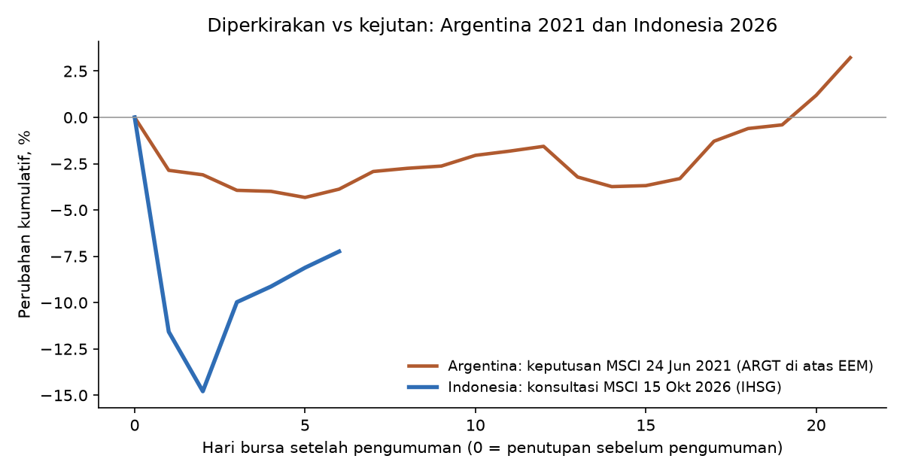

# Argentina 2020-2021: pembanding penurunan status MSCI yang benar-benar terjadi

Sumber tanggal: siaran pers MSCI 2021 Market Classification Review (24 Jun 2021) dan 2020 review (23 Jun 2020). Data: Yahoo Finance (ARGT, EEM). Return di atas EM = ARGT - EEM.

| event | hari0 | jendela | ARGT_% | EEM_% | di_atas_EM_pp |
|---|---|---|---|---|---|
| A1 peringatan (Jun 2020) | 2020-06-24 | [0] | -1.87 | -1.32 | -0.54 |
| A1 peringatan (Jun 2020) | 2020-06-24 | [0,+1] | 0.75 | -0.91 | 1.65 |
| A1 peringatan (Jun 2020) | 2020-06-24 | [0,+5] | -0.37 | -0.88 | 0.51 |
| A1 peringatan (Jun 2020) | 2020-06-24 | [0,+20] | 9.83 | 5.83 | 4.00 |
| A2 keputusan (Jun 2021) | 2021-06-25 | [0] | -2.05 | 0.84 | -2.88 |
| A2 keputusan (Jun 2021) | 2021-06-25 | [0,+1] | -2.20 | 0.93 | -3.13 |
| A2 keputusan (Jun 2021) | 2021-06-25 | [0,+5] | -4.33 | -0.47 | -3.86 |
| A2 keputusan (Jun 2021) | 2021-06-25 | [0,+20] | -3.40 | -6.41 | 3.02 |
| A3 efektif (Nov 2021) | 2021-11-30 | [0] | -1.26 | -0.10 | -1.15 |
| A3 efektif (Nov 2021) | 2021-11-30 | [0,+1] | -1.83 | 0.27 | -2.10 |
| A3 efektif (Nov 2021) | 2021-11-30 | [0,+5] | 3.60 | 2.43 | 1.17 |
| A3 efektif (Nov 2021) | 2021-11-30 | [0,+20] | 6.28 | 0.75 | 5.53 |
| Keputusan -> efektif | 2021-06-25 | 2021-06-25 s.d. 2021-11-30 | -9.73 | -11.26 | 1.53 |
| Efektif -> +1 tahun | 2021-12-01 | 2021-12-01 s.d. 2022-11-30 | 15.80 | -17.18 | 32.98 |
| Peringatan -> keputusan | 2020-06-24 | 2020-06-24 s.d. 2021-06-24 | 34.10 | 36.89 | -2.80 |

