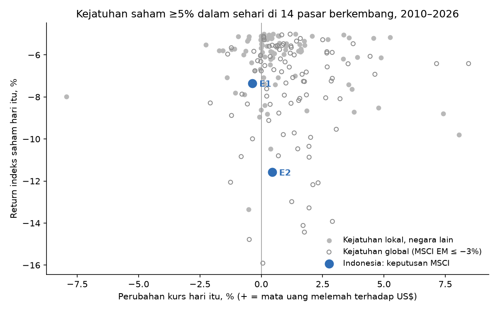

# Indonesia dibanding 13 pasar berkembang lain (2010–2026)

Semua hari bursa 14 negara: 55,031 negara-hari. Episode = indeks saham turun ≥5% dalam sehari (178 episode).

## Seberapa langka

| event | IHSG_% | hari_lebih_buruk_dari_semua_negara | persentil_terburuk_% | hari_lebih_buruk_non_global |
|---|---|---|---|---|
| E1 | -7.35 | 56 | 0.10 | 19 |
| E2 | -11.57 | 11 | 0.02 | 1 |

## Seperti apa dan seberapa cepat pulih (median)

kurs_median_% = perubahan kurs hari-0 (+ melemah); pulih_h5 = porsi titik terdalam [0,+1] yang kembali di hari +5.

| kelompok | n | kurs_median_% | idiosinkratik_median_% | pulih_h5_median |
|---|---|---|---|---|
| Kejatuhan global (negara lain) | 88 | 1.16 | -1.77 | 0.47 |
| Kejatuhan lokal (negara lain) | 88 | 0.37 | -5.12 | 0.32 |
| Indonesia E1 | 1 | -0.36 | -9.17 | -0.11 |
| Indonesia E2 | 1 | 0.45 | -12.39 | 0.51 |

## 12 kejatuhan idiosinkratik terdalam (di luar hari kejatuhan global)

| negara | tanggal | r0_% | idiosinkratik_% | kurs_0_% | pulih_h5 |
|---|---|---|---|---|---|
| Indonesia | 2026-10-16 | -11.57 | -12.39 | 0.45 | 0.51 |
| Filipina | 2020-03-19 | -13.34 | -10.68 | -0.51 | 0.90 |
| Turki | 2021-03-22 | -9.79 | -9.75 | 8.07 | 0.10 |
| Turki | 2013-06-03 | -10.47 | -9.45 | 0.39 | -0.22 |
| Indonesia | 2026-01-28 | -7.35 | -9.17 | -0.36 | -0.11 |
| Turki | 2021-12-21 | -7.99 | -9.14 | -7.94 | 0.18 |
| Turki | 2023-02-07 | -8.62 | -8.72 | -0.01 | 1.51 |
| Vietnam | 2012-08-23 | -8.82 | -8.69 | 0.24 | 0.12 |
| Turki | 2025-03-19 | -8.72 | -8.56 | 3.78 | -0.16 |
| Turki | 2026-05-21 | -6.05 | -8.40 | -0.03 | 0.95 |
| Turki | 2023-01-05 | -7.37 | -8.38 | 0.12 | -0.36 |
| Meksiko | 2024-06-03 | -6.11 | -8.06 | 3.92 | 0.39 |

Catatan: kurs dan indeks negara lain dari Refinitiv (berhenti 16 Okt 2026); rupiah setelah itu dari JISDOR. Negara yang pernah diturunkan MSCI (Argentina, Pakistan, Yunani) belum ada di data ini.