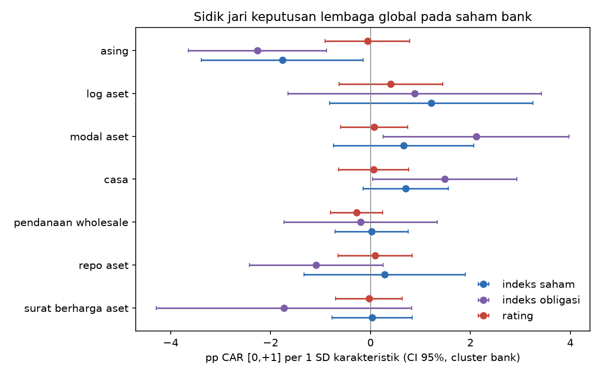

# Heterogenitas: causal forest dan fingerprint

## 8. Causal forest (CausalForestDML, 2.000 pohon, cross-fitting 5 lipatan)

Tumpukan saham di 2 hari event MSCI (T=1) vs 40 hari buruk biasa (T=0). Y = peringkat persentil return hari-0 lintas saham hari itu (0-100; kebal batas ARB). CATE = pergeseran peringkat di hari 'dihakimi' dibanding crash biasa (negatif = membayar lebih dari biasanya).

| kelompok | n | cate | lo | hi |
|---|---|---|---|---|
| Semua saham (hari event) | 1577 | 3.448 | -6.780 | 13.676 |
| Anggota MSCI | 26 | 2.547 | -8.309 | 13.404 |
| Non-MSCI | 1551 | 3.463 | -6.754 | 13.681 |
| Bank | 94 | 7.131 | -2.717 | 16.980 |
| Non-bank | 1483 | 3.215 | -7.037 | 13.467 |
| Bank anggota MSCI | 8 | 2.691 | -9.279 | 14.661 |
| Ukuran kecil | 526 | -1.673 | -10.947 | 7.601 |
| Ukuran menengah | 525 | 5.176 | -4.957 | 15.309 |
| Ukuran besar | 526 | 6.844 | -4.343 | 18.032 |

Kepentingan variabel (porsi split terbobot):

| variabel | kepentingan |
|---|---|
| log_amihud | 0.353 |
| beta_mxef | 0.187 |
| log_mcap | 0.181 |
| ret_pre | 0.152 |
| free_float | 0.127 |
| bank | 0.000 |
| msci | 0.000 |

## 9. Fingerprint lintas jenis keputusan (bank saja)

Panel 273 observasi bank x event dari 48 bank, 6 event non-placebo. Y = CAR [0,+1], FE event, X terstandar (1 SD), SE cluster per bank. Fundamental: Des 2025 untuk event s.d. Apr 2026, Jun 2026 sesudahnya.

| uji | chi2 | df | p | y |
|---|---|---|---|---|
| indeks_saham = rating | 15.788 | 7 | 0.027 | car_0_1 |
| indeks_saham = indeks_obligasi | 3.340 | 7 | 0.852 | car_0_1 |
| indeks_obligasi = rating | 16.491 | 7 | 0.021 | car_0_1 |
| semua X = 0 di indeks_obligasi | 23.914 | 7 | 0.001 | car_0_1 |
| semua X = 0 di indeks_saham | 9.953 | 7 | 0.191 | car_0_1 |
| semua X = 0 di rating | 4.723 | 7 | 0.694 | car_0_1 |
| placebo (S&P, FTSE Okt): semua X = 0 | 10.044 | 7 | 0.186 | car_0_1 |
| indeks_saham = rating | 19.134 | 7 | 0.008 | car_0 |
| indeks_saham = indeks_obligasi | 4.885 | 7 | 0.674 | car_0 |
| indeks_obligasi = rating | 11.780 | 7 | 0.108 | car_0 |
| semua X = 0 di indeks_obligasi | 12.505 | 7 | 0.085 | car_0 |
| semua X = 0 di indeks_saham | 13.768 | 7 | 0.055 | car_0 |
| semua X = 0 di rating | 5.518 | 7 | 0.597 | car_0 |
| placebo (S&P, FTSE Okt): semua X = 0 | 8.366 | 7 | 0.301 | car_0 |

Koefisien (pp per 1 SD):

| variabel | grup | koef | se | p |
|---|---|---|---|---|
| surat_berharga_aset | indeks_obligasi | -1.730 | 1.304 | 0.185 |
| surat_berharga_aset | indeks_saham | 0.031 | 0.410 | 0.940 |
| surat_berharga_aset | rating | -0.032 | 0.341 | 0.925 |
| repo_aset | indeks_obligasi | -1.089 | 0.683 | 0.111 |
| repo_aset | indeks_saham | 0.286 | 0.825 | 0.729 |
| repo_aset | rating | 0.091 | 0.379 | 0.811 |
| pendanaan_wholesale | indeks_obligasi | -0.198 | 0.781 | 0.800 |
| pendanaan_wholesale | indeks_saham | 0.025 | 0.373 | 0.947 |
| pendanaan_wholesale | rating | -0.279 | 0.264 | 0.291 |
| casa | indeks_obligasi | 1.483 | 0.736 | 0.044 |
| casa | indeks_saham | 0.700 | 0.434 | 0.107 |
| casa | rating | 0.063 | 0.358 | 0.859 |
| modal_aset | indeks_obligasi | 2.113 | 0.950 | 0.026 |
| modal_aset | indeks_saham | 0.668 | 0.716 | 0.351 |
| modal_aset | rating | 0.073 | 0.343 | 0.831 |
| log_aset | indeks_obligasi | 0.885 | 1.292 | 0.494 |
| log_aset | indeks_saham | 1.217 | 1.038 | 0.241 |
| log_aset | rating | 0.408 | 0.530 | 0.442 |
| asing | indeks_obligasi | -2.265 | 0.705 | 0.001 |
| asing | indeks_saham | -1.767 | 0.827 | 0.033 |
| asing | rating | -0.062 | 0.432 | 0.885 |

Regresi bivariat per event (pp CAR [0,+1] per 1 SD; ** p<0,05, * p<0,1; HC3):

| variabel | E1 | MDY | FTSE1 | FCH | JPM | SP | FTSE2 | E2 |
|---|---|---|---|---|---|---|---|---|
| surat_berharga_aset | -1.26 | 0.46 | -0.57 | -0.43 | -1.31 | 0.12 | 0.01 | 1.6 |
| repo_aset | -0.89 | -0.05 | -0.7** | 0.29 | -1.02 | -0.25 | 0.18 | 1.22 |
| pendanaan_wholesale | 0.91 | -0.3 | 0.33 | -0.04 | 0.27 | 0.18 | 0.45 | -0.66 |
| casa | 0.33 | 0.28 | -0.64** | 0.22 | -0.07 | -0.09 | -0.27 | 1.65 |
| modal_aset | 0.22 | -0.28 | -0.06 | 0.02 | 1.25 | 0.24 | 0.29 | -0.36 |
| log_aset | 0.75 | 0.23 | -0.58* | 0.36 | -0.71 | -0.14 | 0.02 | -0.09 |
| asing | 0.36 | -0.02 | -0.54** | 0.52** | -1.18** | 0.18 | -0.07 | -1.75** |

Catatan: n bank per event kecil (~45), jadi koefisien individual lebar; yang diuji terutama sidik jari bersama (Wald). surat_berharga_aset = proksi eksposur SBN dari XBRL (surat berharga + obligasi pemerintah bila dilaporkan terpisah). asing = porsi asing dalam volume transaksi, 60 hari bursa sebelum E1.