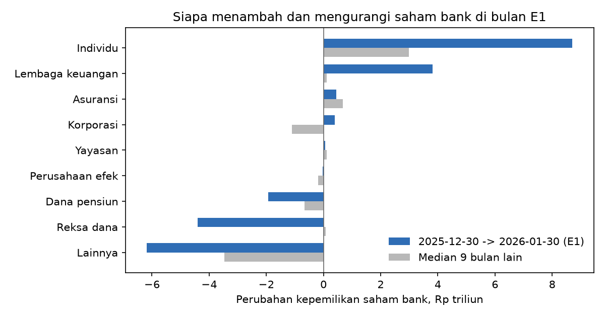

# Siapa yang membeli saham bank saat E1?

Perubahan kepemilikan KSEI per tipe investor di 49 saham bank, 2025-12-30 -> 2026-01-30 (bulan event), dalam Rp T, dibanding 9 bulan lain (Nov 2025-Sep 2026). Tipe = gabungan lokal dan asing (data 2025 tidak memisahkannya); kolom porsi asing menunjukkan seberapa asing tipe itu di saham bank per 30 Jan 2026.

Menurut transaksi harian BEI, asing beli-bersih saham bank Rp-16.5 T sepanjang bulan itu.

| nama_tipe | e1_rp_T | median_bulan_lain | z | peringkat_dari_atas | porsi_asing_30jan |
|---|---|---|---|---|---|
| Individu | 8.71 | 2.98 | 0.75 | 4 | 0.02 |
| Lembaga keuangan | 3.82 | 0.11 | 1.07 | 3 | 0.69 |
| Asuransi | 0.46 | 0.67 | -0.33 | 6 | 0.27 |
| Korporasi | 0.39 | -1.11 | -0.16 | 5 | 0.48 |
| Yayasan | 0.06 | 0.12 | -0.51 | 8 | 0.36 |
| Perusahaan efek | -0.04 | -0.18 | 0.25 | 5 | 0.79 |
| Dana pensiun | -1.93 | -0.67 | -1.00 | 9 | 0.89 |
| Reksa dana | -4.40 | 0.08 | -0.65 | 8 | 0.85 |
| Lainnya | -6.18 | -3.47 | -0.18 | 7 | 0.73 |

## Semua kelompok saham

| kelompok | tipe | nama_tipe | e1_rp_T | median_bulan_lain | z | peringkat_dari_atas | n_bulan |
|---|---|---|---|---|---|---|---|
| Bank | CP | Korporasi | 0.39 | -1.11 | -0.16 | 5 | 10 |
| Bank | FD | Yayasan | 0.06 | 0.12 | -0.51 | 8 | 10 |
| Bank | IB | Lembaga keuangan | 3.82 | 0.11 | 1.07 | 3 | 10 |
| Bank | ID | Individu | 8.71 | 2.98 | 0.75 | 4 | 10 |
| Bank | IS | Asuransi | 0.46 | 0.67 | -0.33 | 6 | 10 |
| Bank | MF | Reksa dana | -4.40 | 0.08 | -0.65 | 8 | 10 |
| Bank | OT | Lainnya | -6.18 | -3.47 | -0.18 | 7 | 10 |
| Bank | PF | Dana pensiun | -1.93 | -0.67 | -1.00 | 9 | 10 |
| Bank | SC | Perusahaan efek | -0.04 | -0.18 | 0.25 | 5 | 10 |
| Lainnya | CP | Korporasi | 12.84 | 10.27 | -0.32 | 4 | 10 |
| Lainnya | FD | Yayasan | 0.04 | -0.03 | 0.42 | 3 | 10 |
| Lainnya | IB | Lembaga keuangan | 6.64 | 0.35 | 0.58 | 3 | 10 |
| Lainnya | ID | Individu | 7.00 | 3.26 | -0.20 | 4 | 10 |
| Lainnya | IS | Asuransi | -3.73 | -0.26 | -3.78 | 10 | 10 |
| Lainnya | MF | Reksa dana | 5.46 | 1.02 | 0.42 | 2 | 10 |
| Lainnya | OT | Lainnya | -6.77 | -4.71 | 0.10 | 6 | 10 |
| Lainnya | PF | Dana pensiun | 0.13 | -0.49 | 0.57 | 4 | 10 |
| Lainnya | SC | Perusahaan efek | -2.26 | -0.10 | -0.70 | 8 | 10 |
| MSCI non-bank | CP | Korporasi | 60.31 | -2.45 | -0.18 | 2 | 10 |
| MSCI non-bank | FD | Yayasan | -0.05 | 0.01 | -1.09 | 9 | 10 |
| MSCI non-bank | IB | Lembaga keuangan | 1.73 | 6.25 | -0.37 | 6 | 10 |
| MSCI non-bank | ID | Individu | -1.28 | 2.42 | 0.16 | 9 | 10 |
| MSCI non-bank | IS | Asuransi | -1.40 | -0.02 | -1.22 | 8 | 10 |
| MSCI non-bank | MF | Reksa dana | 1.74 | 1.26 | -0.35 | 5 | 10 |
| MSCI non-bank | OT | Lainnya | 1.57 | -1.36 | 0.08 | 2 | 10 |
| MSCI non-bank | PF | Dana pensiun | -0.03 | -0.64 | -0.22 | 4 | 10 |
| MSCI non-bank | SC | Perusahaan efek | -0.56 | 1.00 | -0.35 | 7 | 10 |

## Cek silang: perubahan kepemilikan asing KSEI vs beli-bersih asing BEI (lembar)

Pearson semua saham rendah sejak April karena segelintir saham berubah jumlah lembarnya di luar bursa (split, restrukturisasi, pemindahan); korelasi peringkat dan korelasi khusus bank tetap tinggi.

| bulan | korelasi_lintas_saham | spearman_semua | korelasi_bank | ksei_total_mlr_lembar | bei_total_mlr_lembar |
|---|---|---|---|---|---|
| Jan->Feb 2026 | 0.84 | 0.66 | 0.83 | -33.49 | -21.12 |
| Feb->Mar 2026 | 0.84 | 0.72 | 0.93 | -11.60 | -11.34 |
| Mar->Apr 2026 | 0.33 | 0.77 | 0.67 | 26.27 | -22.37 |
| Apr->May 2026 | 0.10 | 0.73 | 0.97 | 13.72 | -7.69 |
| May->Jun 2026 | -0.02 | 0.79 | 0.82 | -72.98 | -12.51 |
| Jun->Jul 2026 | 0.07 | 0.74 | 0.90 | 6.17 | -8.94 |
| Jul->Aug 2026 | -0.06 | 0.75 | 0.84 | 29.76 | -8.51 |
| Aug->Sep 2026 | -0.07 | 0.72 | 0.34 | -15.14 | -11.65 |

Catatan: posisi akhir bulan menangkap seluruh bulan, bukan hanya hari E1 (28-29 Jan). Rp = lembar x rata-rata harga dua akhir bulan, jadi perubahan harga tidak dihitung sebagai beli/jual.