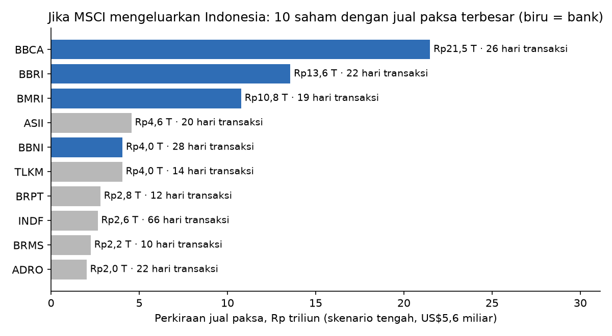

# Skenario jual paksa bila MSCI mengeluarkan Indonesia

Kurs JISDOR 2026-10-23: Rp18.069/US$. Pembagian per saham mengikuti bobot EIDO (proksi MSCI Indonesia IMI). Dampak harga = multiplier IV E2 (-10,0 per 1% saham beredar) x porsi saham yang dijual: ekstrapolasi linear, batas atas kasar.

| Skenario | Total (US$ mlr) | Total (Rp T) | Porsi bank | Jual di bank (Rp T) | Hari transaksi (median saham) | Hari transaksi (bank, tertimbang) | % saham beredar bank | Dampak harga bank (batas atas) |
|---|---|---|---|---|---|---|---|---|
| Rendah: pasif saja (US$3,25 mlr) | 3,25 | 58,7 | 50% | 29,4 | 15,2 | 14,0 | 1,91% | -19,1% |
| Tengah: pasif Goldman (US$5,6 mlr) | 5,60 | 101,2 | 50% | 50,6 | 26,2 | 24,1 | 3,29% | -32,9% |
| Tinggi: pasif + 25% dana aktif | 7,60 | 137,3 | 50% | 68,7 | 35,5 | 32,7 | 4,47% | -44,4% |
| Sangat tinggi: pasif + 50% dana aktif | 9,60 | 173,5 | 50% | 86,7 | 44,9 | 41,3 | 5,64% | -50,0% |

Pembanding: dalam enam hari setelah konsultasi E2, asing sudah menjual bersih saham bank Rp10,5 T.

Sumber estimasi: Goldman Sachs via New Straits Times, 16 Okt 2026 (pasif US$5,6 miliar; dana aktif > US$8 miliar). Skenario rendah US$3,25 miliar dari laporan media yang belum diverifikasi ke riset aslinya.